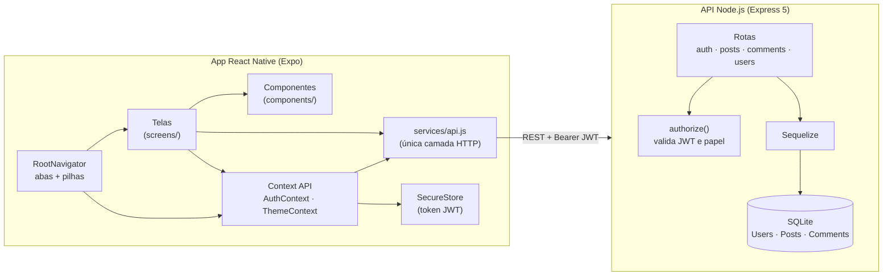
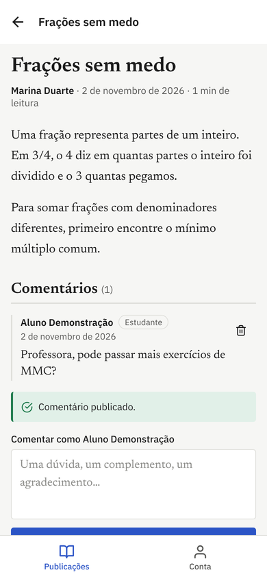
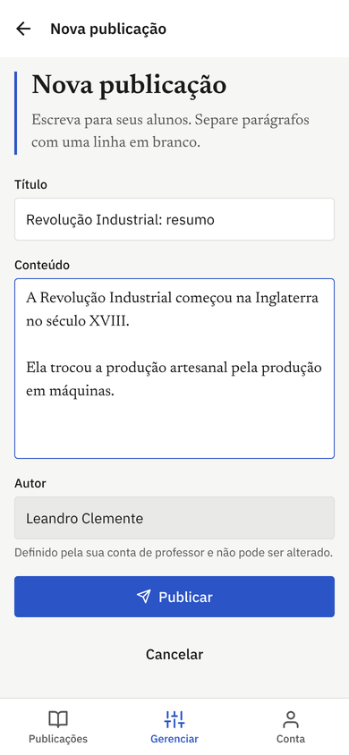
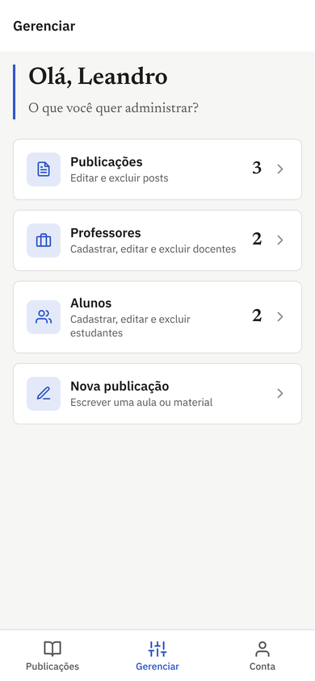
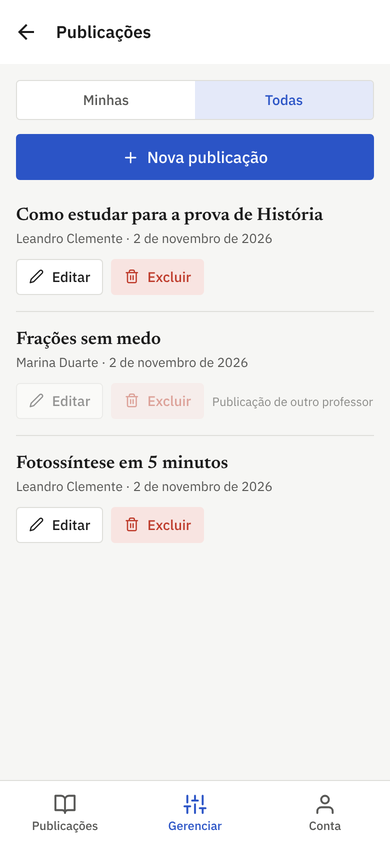
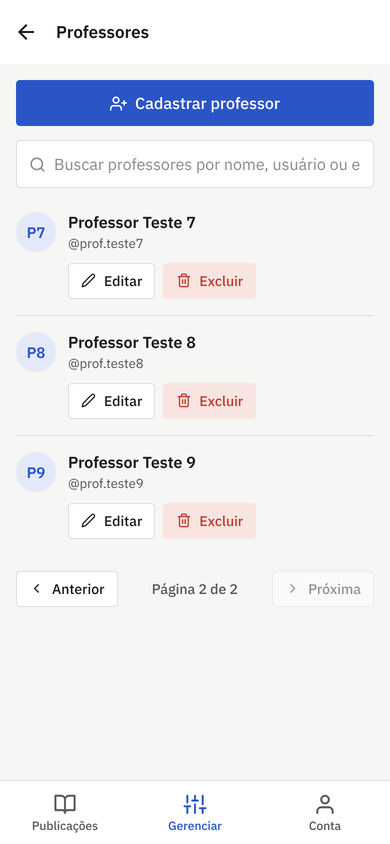
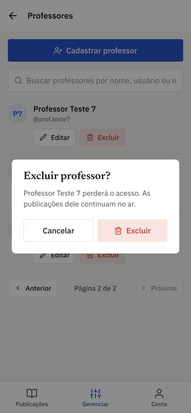
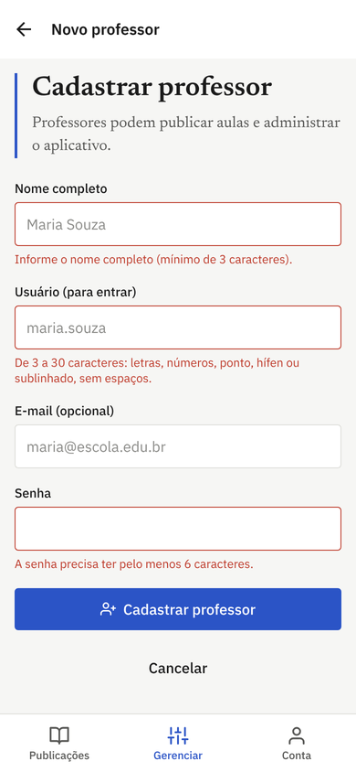
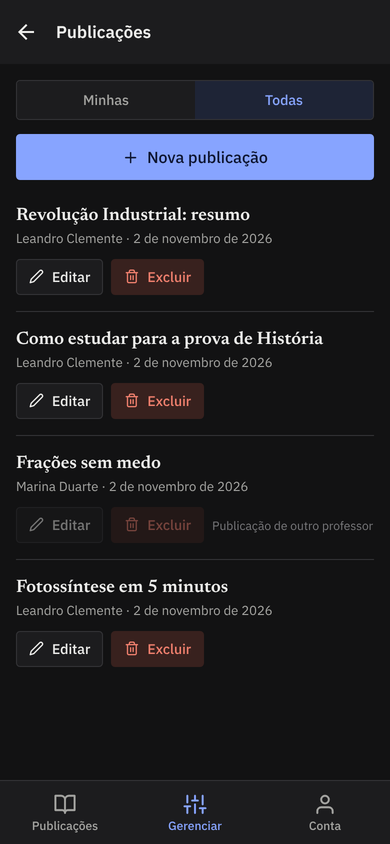

# Tech Challenge — Fase 04 | App Mobile do Blog

Aplicativo **React Native (Expo)** da plataforma de blogging de professores da rede pública, consumindo a API REST em Node.js construída nas fases anteriores — agora evoluída com **usuários reais, senha e administração de professores e alunos**.

**Aluno:** Leandro Clemente — Pós-Graduação em Full Stack Development (FIAP / POSTECH)
**Repositório:** https://github.com/Leandro-Clem/Tech-Challenge-Fase4-Final <!-- confirme o link -->
**Apresentação em vídeo:** https://youtu.be/vjj8h0_UT58 <!-- confirme o link -->

---

## Sumário

- [Visão geral](#visão-geral)
- [O que mudou desde a Fase 3](#o-que-mudou-desde-a-fase-3)
- [Tecnologias](#tecnologias)
- [Estrutura do repositório](#estrutura-do-repositório)
- [Setup inicial](#setup-inicial)
- [Contas de demonstração](#contas-de-demonstração)
- [Arquitetura da aplicação](#arquitetura-da-aplicação)
- [Navegação e autorização](#navegação-e-autorização)
- [Integração com a API](#integração-com-a-api)
- [Gerenciamento de estado](#gerenciamento-de-estado)
- [Estilização](#estilização)
- [Guia de uso](#guia-de-uso)
- [Testes](#testes)
- [CI e Docker](#ci-e-docker)
- [Telas](#telas)

---

## Visão geral

| # | Requisito do desafio | Onde está |
| :-- | :-- | :-- |
| 1 | Lista de posts com título, autor, descrição e busca | `mobile/src/screens/HomeScreen.js` |
| 2 | Leitura do post completo + comentários (opcional) | `PostDetailScreen.js` + `components/Comments.js` |
| 3 | Criação de postagens (título, conteúdo, autor) | `PostFormScreen.js` (sem `id`) |
| 4 | Edição de postagens com os dados atuais carregados | `PostFormScreen.js` (com `id`) |
| 5 | Cadastro de professores | `UserFormScreen.js` (`role: 'professor'`) |
| 6 | Edição de professores | `UserFormScreen.js` (`role: 'professor'`, `id`) |
| 7 | Listagem **paginada** de professores com Editar/Excluir | `UsersListScreen.js` (`role: 'professor'`) |
| 8 | Itens 5, 6 e 7 para alunos | as mesmas telas com `role: 'aluno'` |
| 9 | Página administrativa de posts com Editar/Excluir | `AdminPostsScreen.js` |
| 10 | Login e proteção das páginas restritas | `LoginScreen.js` + `navigation/RootNavigator.js` |

Requisitos técnicos:

- **React Native** com **componentes funcionais e hooks** em 100% do código (não há componentes de classe).
- **Estilização** própria, com tokens de design herdados da Fase 3 e modo claro/escuro.
- **Integração REST** com posts, professores, alunos e autenticação (`mobile/src/services/api.js`).
- **Permissões:** professores criam/modificam; alunos apenas visualizam (e comentam). Validado na API **e** refletido na navegação.
- **Estado global** com **Context API** (`AuthContext`, `ThemeContext`).

---

## O que mudou desde a Fase 3

A Fase 4 pede CRUD de professores e alunos, que a API ainda não tinha. Aproveitamos para corrigir os pontos levantados na correção da fase anterior:

| Apontamento da Fase 3 | Solução na Fase 4 |
| :-- | :-- |
| Login sem senha: o formulário escolhia `username` + `role`, então qualquer um entrava como professor | Tabela `Users` com senha em **hash bcrypt**. `POST /login` recebe `{ username, password }`; o **papel vem do cadastro**, nunca do corpo da requisição. Há teste garantindo que enviar `role: 'professor'` no login é ignorado. |
| Falta de teste da tela de criação de post | `PostFormScreen.test.js` cobre criação (campos, validação, payload, erro do servidor, erro por campo) e edição. |
| `node_modules` enviado na entrega | `.gitignore` na raiz e em cada projeto. O pacote de entrega é gerado sem `node_modules`. |

Outras melhorias na API: posts ligados ao dono por `authorId` (a regra "só o autor altera" não depende mais de um texto), validação com erros por campo, `GET /me`, tratamento central de erros e CORS para a versão web.

---

## Tecnologias

| Camada | Tecnologia |
| :-- | :-- |
| App | React Native 0.88 + **Expo SDK 58** |
| Navegação | React Navigation 7 (bottom tabs + native stack) |
| Estado global | Context API |
| Armazenamento do token | `expo-secure-store` (Keychain/Keystore); AsyncStorage na web |
| Ícones / fontes | `@expo/vector-icons` (Feather), Newsreader e IBM Plex Sans via `expo-font` |
| Testes do app | Jest (`jest-expo`) + React Native Testing Library 14 |
| API | Node.js, Express 5, Sequelize 6, SQLite, JWT, bcryptjs |
| Testes da API | Jest + Supertest |
| Infra | Docker / Docker Compose, GitHub Actions |

---

## Estrutura do repositório

```
Tech-Challenge-Fase4/
├── backend/                  API REST (evolução da Fase 2/3)
│   ├── index.js              inicialização, migração de colunas e seed
│   ├── src/
│   │   ├── app.js            Express: rotas, CORS, erros
│   │   ├── database.js       modelos User, Post, Comment
│   │   ├── authMiddleware.js JWT: authorize(), signToken()
│   │   ├── validation.js     validação e paginação
│   │   ├── seed.js           dados de demonstração
│   │   └── routes/           auth, posts, comments, users (fábrica)
│   └── tests/                54 testes (Jest + Supertest)
├── mobile/                   App React Native (Expo)
│   ├── App.js                provedores + fontes + NavigationContainer
│   └── src/
│       ├── config.js         descoberta do endereço da API
│       ├── services/         api.js (todas as chamadas REST), storage.js
│       ├── context/          AuthContext, ThemeContext
│       ├── navigation/       RootNavigator (abas, pilhas, guarda de rotas)
│       ├── screens/          9 telas (+ testes)
│       ├── components/       ui, PostCard, Comments, Pagination, ConfirmDialog, Screen
│       ├── hooks/            useDebouncedValue
│       ├── theme/            tokens de design
│       └── utils/            formatação de datas e textos
├── docs/screenshots/
├── docker-compose.yml
└── .github/workflows/ci.yml
```

---

## Setup inicial

**Pré-requisitos:** Node.js **22** ou superior, npm, e o app **Expo Go** no celular (Android ou iOS) — ou um emulador Android / simulador iOS.

### 1. API

```bash
cd backend
npm install
npm start          # http://localhost:3000
```

No primeiro start, a API cria o banco `database.sqlite` e as [contas de demonstração](#contas-de-demonstração). Para recriar o banco do zero: `npm run seed`.

Ou com Docker: `docker compose up --build` (na raiz).

### 2. App

Em outro terminal:

```bash
cd mobile
npm install
npm start          # abre o Expo; leia o QR code com o Expo Go
```

Atalhos no terminal do Expo: `a` abre no emulador Android, `i` no simulador iOS, `w` no navegador.

### Como o app encontra a API

`src/config.js` resolve o endereço nesta ordem:

1. `EXPO_PUBLIC_API_URL` em `mobile/.env` (copie de `.env.example`), ex.: `http://192.168.0.10:3000`;
2. sem `.env`, o **IP da máquina que está rodando o Expo** (o mesmo do QR code), porta 3000 — funciona direto no Expo Go quando celular e computador estão na mesma rede Wi-Fi;
3. emulador Android: `http://10.0.2.2:3000`; web e simulador iOS: `http://localhost:3000`.

O endereço em uso aparece no rodapé da aba **Conta**. Se o celular não conectar, confira se o firewall libera a porta 3000.

### Variáveis da API (`backend/.env.example`)

| Variável | Padrão | Uso |
| :-- | :-- | :-- |
| `PORT` | `3000` | porta HTTP |
| `JWT_SECRET` | `Chave_TechChallenge` | chave de assinatura do token (troque em produção) |
| `JWT_EXPIRES_IN` | `8h` | validade do token |
| `DB_STORAGE` | `./database.sqlite` | arquivo do banco (`:memory:` nos testes) |
| `SEED_ON_START` | `true` | cria dados de demonstração se não houver usuários |

---

## Contas de demonstração

| Perfil | Usuário | Senha |
| :-- | :-- | :-- |
| Professor | `professor` | `professor123` |
| Professora | `marina` | `marina123` |
| Aluno | `aluno` | `aluno123` |
| Aluno | `pedro` | `pedro123` |

---

## Arquitetura da aplicação



**Camadas do app**

- **Telas** cuidam só de estado de tela (carregando, erro, formulário) e chamam o serviço.
- **`services/api.js`** é o único lugar que conhece URLs e `fetch`: monta cabeçalhos, injeta o `Bearer`, converte erros em `ApiError` (com `status` e `fieldErrors`) e avisa o `AuthContext` quando recebe 401.
- **Contexts** guardam o que é global: usuário logado e tema.
- **Componentes** reutilizáveis (`ui.js`) recebem o tema por `useStyles`, então nenhuma tela tem cor fixa.

**Decisões principais**

- **Uma tela para criar e editar** (posts e usuários): sem `id` cria, com `id` carrega e atualiza. Menos código duplicado e comportamento idêntico.
- **Professores e alunos usam as mesmas telas e a mesma rota da API** (`userRoutes(role)` no back, `usersApi(role)` no app). O requisito 8 ("replicar para alunos") vira um parâmetro.
- **Confirmação própria** (`ConfirmDialog`) em vez de `Alert.alert`: funciona igual em Android, iOS e web, segue o tema e é testável.
- **Recarregar ao voltar o foco** (`useFocusEffect`): depois de criar/editar/excluir, a lista anterior se atualiza sozinha.

---

## Navegação e autorização

```
Root (stack)
├── Tabs
│   ├── Publicações (stack): Home → PostDetail → PostForm*        * só professor
│   ├── Gerenciar*  (stack): AdminHome → AdminPosts / UsersList → UserForm / PostForm
│   └── Conta       (stack): Account
└── Login (modal)
```

- As telas de criação/edição e toda a aba **Gerenciar** só são **registradas** quando o usuário é professor. Para aluno e visitante essas rotas não existem — não há caminho até elas. Ao sair da conta, as telas são desmontadas.
- A API **valida de novo** cada operação (`authorize('professor')` e checagem de autoria); a interface apenas evita o caminho.
- Um professor só edita/exclui **as próprias** publicações. Na administração, posts de outros aparecem com os botões desabilitados e o motivo. Publicações cujo autor foi excluído ficam "sem dono" e podem ser administradas por qualquer professor.
- O professor não pode excluir a própria conta, e o sistema mantém sempre pelo menos um professor.

---

## Integração com a API

| Método | Rota | Acesso | Uso no app |
| :-- | :-- | :-- | :-- |
| POST | `/login` | público | Login (`{ username, password }` → `{ token, user }`) |
| GET | `/me` | autenticado | revalidar sessão ao abrir o app |
| GET | `/posts` | público | Home, Administração |
| GET | `/posts/search?q=` | público | busca na Home (título, conteúdo ou autor) |
| GET | `/posts/:id` | público | leitura e edição |
| POST | `/posts` | professor | nova publicação |
| PUT | `/posts/:id` | professor autor | salvar edição |
| DELETE | `/posts/:id` | professor autor | excluir |
| GET | `/posts/:id/comments` | público | comentários |
| POST | `/posts/:id/comments` | autenticado | comentar |
| DELETE | `/comments/:id` | dono do post ou autor do comentário | remover comentário |
| GET | `/professores?page&limit&q` | professor | lista paginada → `{ data, page, limit, total, totalPages }` |
| GET / POST | `/professores/:id`, `/professores` | professor | carregar / cadastrar |
| PUT / DELETE | `/professores/:id` | professor | editar / excluir |
| … | `/alunos` (mesmas 5 rotas) | professor | CRUD de alunos |

Códigos usados: `400` validação (com `errors` por campo), `401` sem token / token inválido, `403` sem permissão, `404` não encontrado, `409` usuário já existe.

---

## Gerenciamento de estado

- **`AuthContext`** — `user`, `isAuthenticated`, `isTeacher`, `login()`, `logout()`. Guarda o token no SecureStore; ao abrir o app valida o token em `GET /me`; qualquer `401` em rota autenticada encerra a sessão automaticamente.
- **`ThemeContext`** — segue o tema do sistema ou a escolha da pessoa (Sistema / Claro / Escuro), salva entre aberturas.
- Estado de tela (listas, formulários, carregamento) fica local em cada tela com `useState`/`useEffect`. Redux não foi necessário: o estado compartilhado é pequeno.

---

## Estilização

- **Tokens de design** em `src/theme/tokens.js` com a mesma paleta "grafite" do site da Fase 3 (papel neutro e azul de caneta), para que web e mobile pareçam o mesmo produto.
- **Tipografia:** Newsreader (serifa) para leitura e títulos, IBM Plex Sans para interface.
- **Modo escuro** completo, inclusive cabeçalhos e abas (tema do React Navigation ligado ao nosso).
- **Acessibilidade:** `accessibilityRole`/`accessibilityLabel` em botões e campos, alvos de toque de 44pt, mensagens de erro anunciadas (`accessibilityLiveRegion`), e o teclado não cobre o campo em foco.
- Em tablets e na web o conteúdo fica numa coluna de no máximo 720px.

---

## Guia de uso

**Visitante / aluno**

1. A aba **Publicações** lista os posts (o mais recente em destaque). Digite no campo de busca para filtrar — a busca vai à API após uma pausa na digitação.
2. Toque num post para ler o conteúdo completo e os comentários. Puxe a lista para baixo para atualizar.
3. Para comentar, toque em **Entrar para comentar** e use sua conta de aluno. Você pode remover os próprios comentários.

**Professor**

1. Entre pela aba **Conta → Entrar** (ou por "Entrar para comentar").
2. Aparecem o botão **Escrever** na lista e a aba **Gerenciar**.
3. **Gerenciar → Publicações:** filtro Minhas/Todas, com **Editar** e **Excluir** em cada item.
4. **Gerenciar → Professores / Alunos:** lista paginada com busca, **Cadastrar**, **Editar** e **Excluir** (com confirmação). Na edição, deixe a senha em branco para mantê-la.
5. Na leitura de um post seu, também há Editar/Excluir e você pode moderar os comentários.
6. **Conta:** tema claro/escuro e **Sair da conta**.

---

## Testes

```bash
cd backend && npm test        # 54 testes — auth, posts, comentários, CRUD de professores e alunos
cd mobile  && npm test        # 72 testes — telas, contexto de autenticação, serviço, navegação
npm run test:coverage         # em qualquer um dos dois
```

**API (Jest + Supertest, banco em memória):** login com senha (inclusive tentativa de forçar o papel), 401/403 nas rotas protegidas, autoria dos posts, moderação de comentários, CRUD e paginação de professores e alunos (os mesmos testes rodam para os dois papéis), regras de exclusão. Cobertura ~93% das linhas.

**App (jest-expo + Testing Library):**

| Arquivo | O que cobre |
| :-- | :-- |
| `PostFormScreen.test.js` | **criação de post**: campos, autor bloqueado, validação, payload enviado, erros do servidor; edição carregando dados |
| `UsersScreens.test.js` | listagem paginada, próxima página, Editar, Excluir com confirmação/cancelamento, cadastro e edição (para professor **e** aluno) |
| `PostsScreens.test.js` | lista com título/autor/descrição, busca com debounce, leitura, comentário, administração com botões bloqueados para posts alheios |
| `LoginScreen.test.js` | usuário + senha, validação, erro de credenciais |
| `RootNavigator.test.js` | aba Gerenciar só existe para professor |
| `AuthContext.test.js` | login salva o token, restauração via `/me`, descarte de token vencido, logout |
| `api.test.js`, `format.test.js` | cabeçalho Bearer, erros, 401, rotas de usuários, resolução do endereço da API |

---

## CI e Docker

- **GitHub Actions** (`.github/workflows/ci.yml`): dois jobs a cada push — testes da API e testes do app, seguidos de `expo export` para garantir que o bundle compila.
- **Docker:** `docker compose up --build` sobe a API com o banco num volume persistente. O app mobile roda pelo Expo (não faz sentido containerizá-lo).

---

## Telas

| Lista e busca | Leitura e comentários | Nova publicação |
| :-: | :-: | :-: |
|  |  |  |

| Gerenciar | Administração de posts | Professores (paginado) |
| :-: | :-: | :-: |
|  |  |  |

| Confirmação de exclusão | Validação do cadastro | Modo escuro |
| :-: | :-: | :-: |
|  |  |  |
